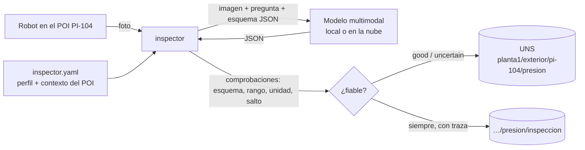

# POI Vision Inspector

[](https://github.com/aseinotegi/poi-vision-inspector/actions/workflows/ci.yml)


[English](README.md) · **Español**

Inspección visual para robots **configurada por punto de interés, en vez de entrenada por objeto**. El robot se para en un POI y hace una foto. A un modelo multimodal se le hace la pregunta escrita para ese sitio en concreto: *"esto es el PI-104, un manómetro de 0 a 10 bar, léelo"*. La respuesta vuelve en JSON, se contrasta con lo que la planta ya sabe de ese POI y se publica en el Unified Namespace.

El modelo puede correr **en tu propia máquina** (Ollama, vLLM, LM Studio) o en la nube (Gemini o cualquier API compatible con OpenAI). La configuración es la misma y solo cambia una línea.



## Por qué por POI y no con un detector entrenado

Un robot no va a cualquier sitio. Se para en puntos conocidos, y en cada uno ya sabemos qué tiene que haber y en qué rango debe marcar. Aprovechar eso cambia el problema:

| | Detector entrenado (p. ej. YOLO) + lector | Pregunta por POI a un modelo multimodal |
|---|---|---|
| Nuevo tipo de objeto | Recoger y etiquetar fotos, reentrenar, validar | Escribir un perfil en YAML |
| Contexto (tag, rango, unidad) | No se usa | Va en la pregunta y en las comprobaciones |
| Explica su respuesta | No | Campo `evidence`, una frase |
| Coste por foto | Muy bajo | Una llamada al modelo (GPU local o API) |
| Muchos objetos por foto, mucha frecuencia | Encaja mejor | Encaja peor |

Para rondas de robot, con pocas fotos por POI, separadas por minutos y con un rango de respuesta conocido, gana la segunda columna. Para vídeo o escenas con muchos objetos, un detector sigue siendo la herramienta adecuada.

## Por qué primero en local

- **Las fotos de una planta muchas veces no pueden salir de ella.** Con Ollama la imagen no sale de la red.
- **Una latencia que controlas tú.** Si una regla espera la lectura para actuar, una GPU local responde en pocos segundos, sin límites de uso ni caídas que no dependen de ti.
- **Sin atarte a nadie.** Los perfiles y los POIs no saben qué modelo les contesta.

## Arranque rápido

Todo en local, con un robot de demo que manda fotos sintéticas:

```bash
docker compose up --build        # la primera vez descarga el modelo de visión (varios GB)
docker compose exec broker mosquitto_sub -t 'planta1/exterior/#' -v
```

Una foto desde la línea de comandos:

```bash
pip install -e ".[gemini]"
poi-inspect read foto.jpg --poi PI-104                     # con el proveedor configurado
```

La salida tiene esta forma (valores de ejemplo):

```json
{
  "poi": "PI-104", "kind": "numeric", "value": 6.8, "unit": "bar",
  "status_reason": "lectura_valida", "confidence": 0.95,
  "evidence": "needle just below the 7 mark",
  "quality": "good", "checks": [],
  "trace": {"provider": "ollama", "model": "qwen3-vl", "prompt": "e2ad9e75ce7b",
            "image_sha256": "42ed9d11c876508d", "latency_ms": 4120}
}
```

## Configuración

Un único fichero, [config/inspector.yaml](config/inspector.yaml), que se valida al arrancar (`poi-inspect check`):

```yaml
provider:
  kind: ollama            # ollama | openai | gemini | replay
  model: qwen3-vl
  url: http://localhost:11434

profiles:
  manometro:
    kind: numeric
    description: an analog pressure gauge (round dial with a needle and a printed scale)
    instruction: |
      Find the pressure gauge and read where the needle tip points on the scale...
    reasons: [lectura_valida, no_legible, no_encontrado]
    min_confidence: 0.8

pois:
  PI-104:
    profile: manometro
    tag: PI-104
    uns_topic: planta1/exterior/pi-104/presion
    expect: { unit: bar, min: 0, max: 10, max_step: 3 }
    hint: the larger gauge, on the right   # opcional: cuál, si en la foto hay varios
```

Los prompts van en inglés porque los modelos abiertos locales los siguen con más fiabilidad. Las claves y los topics llevan los nombres de la planta.

### Añadir un caso nuevo: el extintor

Este es todo el cambio para empezar a revisar extintores. Ni fotos que etiquetar ni entrenamiento:

```yaml
profiles:
  extintor:
    kind: state
    description: a portable fire extinguisher hanging on its wall bracket, under its sign
    instruction: |
      Check that the extinguisher is on its bracket and that the needle of its small
      pressure gauge is inside the green band. An empty bracket means it is missing.
    values: [OK, NOK]
    reasons: [correcto, ausente, presion_baja, no_legible]

pois:
  EXT-12:
    profile: extintor
    tag: EXT-12
    uns_topic: planta1/exterior/ext-12/estado
```

### Proveedores

| `kind` | Dónde corre | Notas |
|---|---|---|
| `ollama` | tu máquina | El esquema JSON se impone mientras genera (decodificación restringida) |
| `openai` | cualquier servidor compatible con OpenAI | vLLM, LM Studio, el servidor de llama.cpp o la propia OpenAI (`url`, `api_key_env`) |
| `gemini` | nube de Google | `pip install ".[gemini]"`; la clave va en la variable que indica `api_key_env` |
| `replay` | ningún sitio | Respuestas grabadas por hash de imagen: tests, CI y demos sin conexión |

Dónde corre el modelo también puede venir del entorno (`POI_PROVIDER_URL`, `POI_PROVIDER_MODEL`), así que el mismo YAML vale en un portátil y en planta. Los ensayos de visión (fotos enviadas a propósito a `<tema de ensayos>/foto`) puede contestarlos otro modelo: `trial_provider` en el YAML, o `POI_TRIAL_PROVIDER=gemini` y `POI_TRIAL_MODEL` desde el entorno; por ejemplo, las rondas del robot con lecturas grabadas y la foto de un visitante leída por Gemini. El servicio MQTT lee `MQTT_HOST`, `MQTT_PORT` y, para un broker con usuarios y ACL, `MQTT_USERNAME` y `MQTT_PASSWORD`. Al conectarse publica, retenido en `<tema de estado>/config`, su modelo y el prompt y el esquema JSON exactos de cada punto de interés, para que cualquiera en el UNS vea qué se le pregunta al modelo. Cada inspección lleva en su traza la respuesta en bruto del modelo.

## Cuánto fiarse de una respuesta

La `confidence` que da un modelo es una autoevaluación, **no una probabilidad calibrada**. La confianza sale de comprobaciones que no dependen del modelo:

| Comprobación | Resultado si falla |
|---|---|
| La respuesta no es JSON válido, o trae un estado que no está en el perfil | `rejected` |
| Un número fuera de la escala del instrumento | `rejected` (`fuera_de_rango`) |
| Una unidad distinta de la del POI | `uncertain` |
| Un salto mayor que `max_step` desde la última lectura fiable | `uncertain` |
| Un motivo que no está en la lista del perfil o que contradice el valor | `uncertain` |
| Confianza del modelo por debajo del `min_confidence` del perfil | `uncertain` |

"No lo puedo leer" (`no_legible`) es una respuesta válida y se publica tal cual; adivinar no lo es. Una lectura rechazada nunca pisa el último valor del UNS. Las llamadas que no reciben respuesta (red, cuota, servidor) solo se reintentan cuando tiene sentido (429, 5xx, timeouts) y se publican como error, nunca como lecturas vacías.

Cada resultado lleva su **traza**: proveedor, versión del modelo según el propio proveedor, una huella de los prompts y los POIs, el hash de la imagen y la latencia. Si cambia un prompt, el histórico dice exactamente qué lecturas salieron con qué versión.

## Medirlo

```bash
poi-inspect synth data/synthetic                   # 70 fotos etiquetadas, fáciles y difíciles
poi-inspect evaluate data/synthetic --results results.csv --report evaluacion.json
```

El JSON guarda fecha, proveedor y modelo, huella del prompt, hash del dataset y de cada imagen, resultados individuales, confianza declarada y latencia. Separa imágenes únicas, abstenciones, llamadas fallidas y lecturas incorrectas aceptadas como válidas.

El conjunto sintético tiene manómetros con valores conocidos y extintores en estados conocidos, con giro, desenfoque, reflejos, poca luz y ruido. El informe pone primero la cifra que importa en planta: **mal pero dadas por buenas**, lecturas marcadas `good` que en realidad están mal. Son las que moverían a un robot.

Las fotos sintéticas son una referencia reproducible, no sustituyen a las reales. El mismo comando funciona con cualquier carpeta de fotos reales que tenga su `labels.csv`.

## Estructura

```text
src/poi_inspector/
  config.py       proveedor, perfiles y POIs, validados (pydantic)
  prompt.py       POI + perfil → instrucción y esquema JSON; huella de prompts
  inspector.py    preguntar, reintentar y juzgar: calidad y sus motivos
  providers/      ollama · compatible con OpenAI · gemini · replay
  service.py      MQTT: entra la foto, salen el valor y el detalle de la inspección
  evaluate.py     métricas sobre un conjunto etiquetado
  synth.py        manómetros y extintores sintéticos con la respuesta conocida
  demo_robot.py   publica fotos sintéticas para la demo de compose
  cli.py          check · read · synth · evaluate · serve · demo-robot
```

## Tests

```bash
pip install -e ".[dev,gemini]"
pytest -q      # 54 tests, sin modelo y sin red
mypy && ruff check src tests
```

Los proveedores se prueban contra servidores HTTP falsos: la petición exacta que espera cada API y cómo se traduce cada error. El inspector se prueba con respuestas guionizadas que cubren todas las formas en que una respuesta puede venir mal.

## Parte de una serie

| Repositorio | Papel |
|---|---|
| [industrial-uns-demo](https://github.com/aseinotegi/industrial-uns-demo) | El Unified Namespace al que llegan estas lecturas, cruzadas con el PLC |
| [level-gauge-vision-showcase](https://github.com/aseinotegi/level-gauge-vision-showcase) | Un caso en producción: detector entrenado + lector multimodal para indicadores de nivel |
| [andersein.com](https://andersein.com) | La historia completa, dibujada |

---

Licencia MIT · [Ander Sein](https://andersein.com) · [aseinotegi@gmail.com](mailto:aseinotegi@gmail.com)
