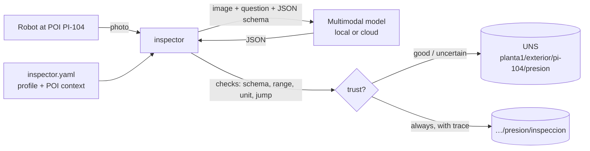

# POI Vision Inspector

[](https://github.com/aseinotegi/poi-vision-inspector/actions/workflows/ci.yml)


**English** · [Español](README.es.md)

Visual inspection for robots, **configured by point of interest instead of trained per object**. The robot stops at a POI, takes a photo, and a multimodal model is asked a question written for that exact spot: *"this is PI-104, a pressure gauge, 0 to 10 bar: read it"*. The answer comes back as JSON, is checked against what the plant knows about that POI, and is published to the Unified Namespace.

The model can run **on your own machine** (Ollama, vLLM, LM Studio) or in the cloud (Gemini, any OpenAI-compatible API). Same configuration, one line changes.



## Why per POI, and not a trained detector

A robot does not wander. It stops at known points, and at each one we already know what should be there and what range it reads. Using that knowledge changes the problem:

| | Trained detector (e.g. YOLO) + reader | Question per POI to a multimodal model |
|---|---|---|
| New kind of object | Collect and label photos, retrain, validate | Write a profile in YAML |
| Context (tag, range, unit) | Not used | Part of the question, and of the checks |
| Explains its answer | No | `evidence` field, one sentence |
| Cost per photo | Very low | One model call (local GPU or API) |
| Many objects per photo, high frame rate | Better fit | Worse fit |

For robot rounds (a few photos per POI, minutes apart, a known answer range) the second column wins. For video or crowded scenes, a detector is still the right tool.

## Why local first

- **Photos of a plant often cannot leave it.** With Ollama the image never leaves the network.
- **Latency you control.** If a rule waits for the reading before acting, a local GPU answers in a few seconds without rate limits or outages you do not own.
- **No lock-in.** Profiles and POIs do not know which model answers them.

## Quick start

Everything local, with a demo robot sending synthetic photos:

```bash
docker compose up --build        # first run downloads the vision model (several GB)
docker compose exec broker mosquitto_sub -t 'planta1/exterior/#' -v
```

One photo from the command line:

```bash
pip install -e ".[gemini]"
poi-inspect read photo.jpg --poi PI-104                    # with the configured provider
```

The output has this shape (illustrative values):

```json
{
  "poi": "PI-104", "kind": "numeric", "value": 6.8, "unit": "bar",
  "status_reason": "lectura_valida", "confidence": 0.95,
  "evidence": "needle just below the 7 mark",
  "quality": "good", "checks": [],
  "trace": {"provider": "ollama", "model": "qwen3-vl", "prompt": "e2ad9e75ce7b",
            "image_sha256": "42ed9d11c876508d", "latency_ms": 4120}
}
```

## Configuration

One file, [config/inspector.yaml](config/inspector.yaml), validated at start-up (`poi-inspect check`):

```yaml
provider:
  kind: ollama            # ollama | openai | gemini | replay
  model: qwen3-vl
  url: http://localhost:11434

profiles:
  manometro:
    kind: numeric
    description: an analog pressure gauge (round dial with a needle and a printed scale)
    instruction: |
      Find the pressure gauge and read where the needle tip points on the scale...
    reasons: [lectura_valida, no_legible, no_encontrado]
    min_confidence: 0.8

pois:
  PI-104:
    profile: manometro
    tag: PI-104
    uns_topic: planta1/exterior/pi-104/presion
    expect: { unit: bar, min: 0, max: 10, max_step: 3 }
```

### Adding a new case: the extinguisher

This is the whole change to start checking fire extinguishers. No photos to label, no training:

```yaml
profiles:
  extintor:
    kind: state
    description: a portable fire extinguisher hanging on its wall bracket, under its sign
    instruction: |
      Check that the extinguisher is on its bracket and that the needle of its small
      pressure gauge is inside the green band. An empty bracket means it is missing.
    values: [OK, NOK]
    reasons: [correcto, ausente, presion_baja, no_legible]

pois:
  EXT-12:
    profile: extintor
    tag: EXT-12
    uns_topic: planta1/exterior/ext-12/estado
```

### Providers

| `kind` | Runs | Notes |
|---|---|---|
| `ollama` | your machine | JSON schema enforced while generating (constrained decoding) |
| `openai` | any OpenAI-compatible server | vLLM, LM Studio, llama.cpp server, or OpenAI itself (`url`, `api_key_env`) |
| `gemini` | Google cloud | `pip install ".[gemini]"`, key in the variable named by `api_key_env` |
| `replay` | nowhere | recorded answers by image hash: tests, CI, offline demos |

Where the model runs can also come from the environment (`POI_PROVIDER_URL`, `POI_PROVIDER_MODEL`), so the same YAML works on a laptop and in a plant.

## How much to trust an answer

The `confidence` a model reports is a self-assessment, **not a calibrated probability**. Trust comes from checks that do not depend on the model:

| Check | Result if it fails |
|---|---|
| Answer is not valid JSON, or a state outside the profile | `rejected` |
| Number outside the instrument's scale | `rejected` (`fuera_de_rango`) |
| Unit different from the POI's | `uncertain` |
| Jump bigger than `max_step` since the last trusted reading | `uncertain` |
| Reason outside the profile's list, or contradicting the value | `uncertain` |
| Model confidence below the profile's `min_confidence` | `uncertain` |

"I cannot read it" (`no_legible`) is a valid answer and is published as such; a guess is not. A rejected reading never overwrites the last value in the UNS. Calls that get no answer at all (network, quota, server) are retried only when it makes sense (429, 5xx, timeouts) and reported as errors, never as empty readings.

Every result carries its **trace**: provider, model version as reported, a fingerprint of the prompts and POIs, the image hash and the latency. When a prompt changes, the history shows exactly which readings came from which version.

## Measuring it

```bash
poi-inspect synth data/synthetic                   # 70 labelled photos, easy and hard
poi-inspect evaluate data/synthetic --results results.csv
```

The synthetic set has gauges at known values and extinguishers in known states, with tilt, blur, glare, darkness and noise. The report puts first the number that matters in a plant: **wrong but trusted**, readings marked `good` that are actually wrong, because those are the ones that would move a robot.

Synthetic photos are a reproducible baseline, not a substitute for real ones: the same command works on any folder of real photos with a `labels.csv`.

## Project layout

```text
src/poi_inspector/
  config.py       provider, profiles and POIs, validated (pydantic)
  prompt.py       POI + profile → instruction and JSON schema; prompt fingerprint
  inspector.py    ask, retry, judge: quality and the reasons behind it
  providers/      ollama · openai-compatible · gemini · replay
  service.py      MQTT: photo in, value and inspection detail out
  evaluate.py     metrics on a labelled set
  synth.py        synthetic gauges and extinguishers with known answers
  demo_robot.py   publishes synthetic photos for the compose demo
  cli.py          check · read · synth · evaluate · serve · demo-robot
```

## Tests

```bash
pip install -e ".[dev,gemini]"
pytest -q      # 54 tests, no model and no network needed
mypy && ruff check src tests
```

Providers are tested against fake HTTP servers (the exact request each API expects, and how each error is mapped); the inspector, against scripted answers covering every way an answer can be wrong.

## Part of a series

| Repository | Role |
|---|---|
| [industrial-uns-demo](https://github.com/aseinotegi/industrial-uns-demo) | The Unified Namespace where these readings land, cross-checked with the PLC |
| [level-gauge-vision-showcase](https://github.com/aseinotegi/level-gauge-vision-showcase) | A production case: trained detector + multimodal reader for level gauges |
| [andersein.com](https://andersein.com) | The whole story, drawn |

---

MIT License · [Ander Sein](https://andersein.com) · [aseinotegi@gmail.com](mailto:aseinotegi@gmail.com)
